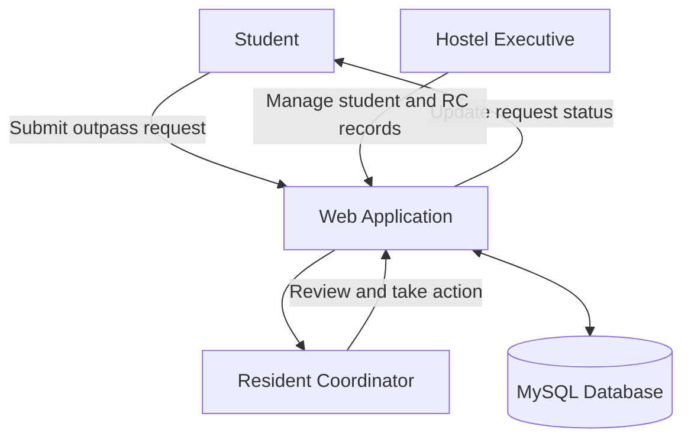
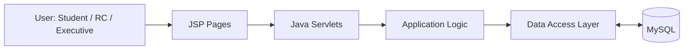

# MIT Hostel Outpass Management

A web-based application that simplifies hostel outpass administration by bringing student requests, approval workflows, and pass history into one place.

<p align="center">
  <a href="https://drive.google.com/file/d/1Bgd68GsP4iVaW8mNXLhFrWTp6QwEprJH/view?usp=sharing"><strong>▶ Watch the Project Demo</strong></a>
  &nbsp; · &nbsp;
  <a href="https://github.com/Shanmugharini/MIT_HostelOutpassMangement/blob/master/project_demo_video.mp4">View demo video in this repository</a>
</p>

---

## The Problem

Hostel outpass requests can become difficult to manage when submitted and tracked manually. Students may have limited visibility into request decisions, while hostel staff need a clear way to review requests and maintain pass records.

**This project digitizes that process** with role-based access for students, Resident Coordinators (RCs), and hostel executives.

## What You Can Do

| User role | Main capabilities |
|---|---|
| **Student** | Register and log in, submit an outpass request, view current and rejected passes, edit request details, and check pass history. |
| **Resident Coordinator (RC)** | Log in, review assigned requests, take action on requests, and view pass history. |
| **Hostel Executive** | Manage student and RC records, view registered users, and access pass history. |

## How It Works



### Application Architecture



## Technology Stack

- **Frontend:** JSP, HTML, CSS
- **Backend:** Java Servlets (Java 17)
- **Database:** MySQL
- **Database connectivity:** JDBC
- **Build:** Maven
- **Application server:** Apache Tomcat 9

## Run Locally

**Prerequisites:** JDK 17, Maven, MySQL, and Apache Tomcat 9.

1. Clone the repository:
   ```bash
   git clone https://github.com/Shanmugharini/MIT_HostelOutpassMangement.git
   cd MIT_HostelOutpassMangement
   ```
2. Create and configure the MySQL database.
3. Set the `DB_URL`, `DB_USER`, and `DB_PASSWORD` environment variables. Follow **[DATABASE_SETUP.md](DATABASE_SETUP.md)** for configuration instructions.
4. Build the application:
   ```bash
   mvn clean package
   ```
5. Deploy the generated WAR from `target/MIT_HostelOutpassMangement.war` to Tomcat 9 and start the server.
6. Open the application in your browser at `http://localhost:8080/` (if deployed as the ROOT application).

> Keep database credentials in environment variables. Do not commit real passwords or populated environment files.

## Project Structure

```text
├── src/main/java/       # Servlets, models, and DAO
├── src/main/webapp/     # JSP pages, CSS, and images
├── WEB-INF/             # Web application configuration
├── DATABASE_SETUP.md   # Database configuration guide
├── pom.xml              # Maven dependencies and build settings
└── Dockerfile           # Container build and deployment
```

---

**Explore the code:** [Repository](https://github.com/Shanmugharini/MIT_HostelOutpassMangement) · **See it in action:** [Project demo](https://drive.google.com/file/d/1Bgd68GsP4iVaW8mNXLhFrWTp6QwEprJH/view?usp=sharing)
